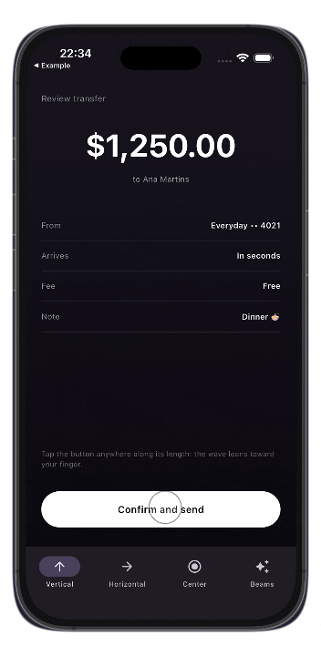

# warp_fx

[](https://pub.dev/packages/warp_fx)

<p align="center">
  
</p>

Two GPU effects for Flutter, written as fragment shaders with no native code:

- **`DistortionWave`**: a colourful lens wave that opens from a button, an
  edge or an avatar and carries one view into another. First a quick pull
  toward the source, then a soft swell with progressive blur and chromatic
  aberration. Colour stays on the edges, with a hairline, after the middle has
  cleared.
- **`BorderBeam`**: an animated glowing border round any widget, either a
  travelling beam or a breathing pulse.

A Flutter port of [libraries.dev/waves](https://libraries.dev/waves) and
[border-beam](https://github.com/Jakubantalik/Libraries.dev/tree/main/packages/border-beam)
by Jakub Antalik, which exist for React, React Native and SwiftUI.

Runs on Android, iOS, macOS, Windows and Linux, with Impeller or Skia.

## Install

```yaml
dependencies:
  warp_fx: ^0.1.0
```

## DistortionWave

```dart
final confirm = GlobalKey();
var sent = false;

Stack(children: [
  DistortionWave(
    isRevealed: sent,
    sourceKey: confirm,            // the wave opens from this widget
    revealed: const ReceiptScreen(),
    child: const ReviewScreen(),
  ),
  // Put the button above the wave to keep it sharp and live.
  Align(
    alignment: Alignment.bottomCenter,
    child: FilledButton(
      key: confirm,
      onPressed: () => setState(() => sent = true),
      child: const Text('Confirm'),
    ),
  ),
]);
```

Setting `isRevealed` to `true` runs the wave forwards. Setting it back to
`false` collapses the wave into its source.

### Types

| Style | From | Use it for |
| --- | --- | --- |
| `DistortionWaveStyle.vertical` | a wide source at the bottom, up the screen | paying, sending, submitting |
| `DistortionWaveStyle.horizontal` | a tall source at the left, across | going to the next step, an edge swipe |
| `DistortionWaveStyle.center` | the centre of a round source, as a ring | a success on an avatar, inside a sheet or card |

Every number can be tuned:

```dart
DistortionWaveStyle.vertical.copyWith(
  palette: WavePalette.ocean,          // colorful, green, ocean, sunset, mono, single(color)
  cornerRadius: 48,                    // the corners the edge colour follows
  blur: 24,
  aberration: 1.2,
)
```

### Parameters

| | | |
| --- | --- | --- |
| `isRevealed` | `bool` | Which view shows. Changing it runs the wave. |
| `child` | `Widget` | The view that shows first. The wave takes its size. |
| `revealed` | `Widget?` | The view the wave leaves behind. If omitted, the wave passes over `child` and leaves it unchanged. |
| `sourceKey` / `source` | `GlobalKey?` / `Rect?` | Where the wave opens from. If neither is given, each type has a sensible default. |
| `focus` | `Offset?` | Where the source was touched. The vertical and horizontal waves lean toward it. |
| `style` | `DistortionWaveStyle` | Look and timing. |
| `scrub` | `double?` | Holds the wave at a point of its run, from 0 to 1. Useful for screenshots. |
| `live` | `bool` | Re-captures the views on every frame, so animations inside them keep moving. |
| `onFinish` | `ValueChanged<bool>?` | Called when a wave ends, with the view it ended on. |

### How it works

When the wave starts, both views are captured as pictures with
`toImageSync`, and two blurred copies of each are made once. A single
fragment shader then draws the lens, the blur, the chromatic aberration and
the colour from one signed distance to the wave front, so they always stay
in sync. The sparks are drawn on a canvas.

Things to know:

- Give both views an opaque background.
- Platform views (maps, web views) can't be captured.
- Content that animates inside a view holds still while the wave passes,
  unless you set `live: true`.
- When the platform asks for reduced motion, or where shaders are
  unavailable, the wave becomes a crossfade.

## BorderBeam

```dart
BorderBeam(
  size: BorderBeamSize.md,       // sm, md, line, pulseInner, pulseOutside
  colorVariant: BorderBeamColorVariant.ocean,
  theme: BorderBeamTheme.auto,
  borderRadius: 16,              // match your child's corners
  child: const MyCard(),
)
```

| | | |
| --- | --- | --- |
| `size` | `BorderBeamSize` | `sm` and `md` travel round the border. `line` glows along the bottom. `pulseInner` and `pulseOutside` breathe. |
| `colorVariant` | `colorful`, `mono`, `ocean`, `sunset` | The palette. |
| `theme` | `dark`, `light`, `auto` | Adapts to the background. |
| `active` | `bool` | Fades the beam in or out, then calls `onActivate` or `onDeactivate`. |
| `strength` | `double` | Opacity of the effect, from 0 to 1. |
| `duration` | `double?` | Seconds per cycle. |
| `brightness`, `saturation`, `hueRange`, `staticColors` | | Colour controls. |
| `tuning` | `BeamTuning` | Proportional boosts. `webDemoPulsePreset` reproduces the web demo. |

`pulseOutside` draws its halo outside the child, behind it. The child must be
opaque, and no ancestor may clip it.

## Example

`example/` is a showcase app for Android, iOS, macOS, Windows and Linux:

```sh
cd example && flutter run
```

## Licence

MIT. Original effects © Jakub Antalik.
